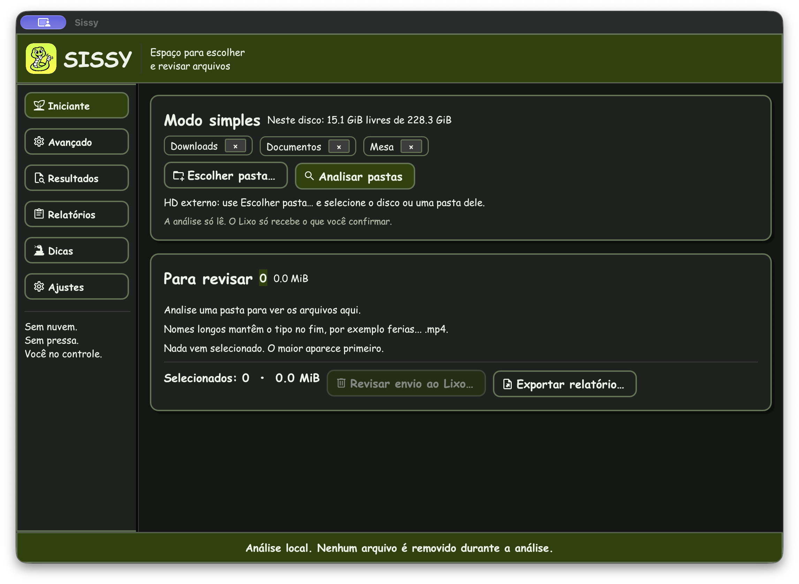
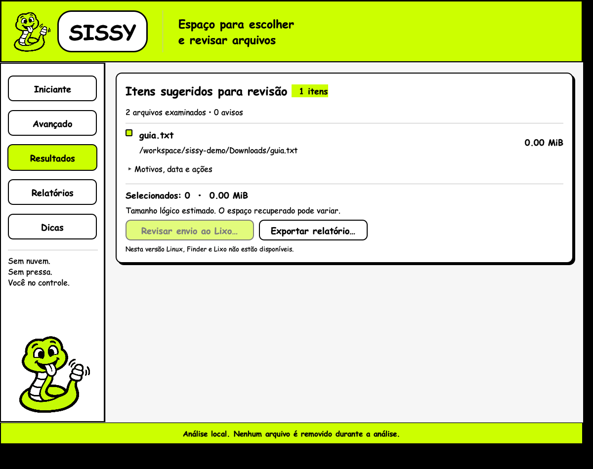

# Sissy

<p align="center">
  <strong>Uma cobrinha para ajudar a organizar o Mac. Quem decide o que fica é você.</strong><br>
  Rust + egui · análise local · português, inglês, espanhol e japonês
</p>

<p align="center">
  <a href="CONTRIBUTING.md"><strong>Quero contribuir</strong></a> ·
  <a href="https://github.com/leonardobluestriker/sissy/issues/new">Sugerir uma ideia ou contar um problema</a> ·
  <a href="#desenvolver-e-testar">Mexer no código</a>
</p>

O **Sissy é um organizador de arquivos para macOS em construção**, com uma cobra verde, cores fortes e uma proposta simples: ajudar você a encontrar arquivos grandes e cópias repetidas, entender o que está ocupando espaço e escolher com calma o que pode ir ao Lixo. Também analisa pastas de HDs externos escolhidas por você.

**Foi vibe-codado, sim. E quero mais gente colocando humanidade nele.** IA ajudou a tirar o projeto do papel, mas há muito espaço para quem programa, desenha, traduz, testa ou simplesmente percebe que um botão está confuso. Quero um aplicativo que respeite o tempo, os arquivos e o jeito de cada pessoa usar o computador.

Pode fazer um fork, experimentar, modificar o código e dar ao Sissy a sua cara. Quer um visual mais discreto? Uma tradução mais natural? Melhor acessibilidade, desempenho ou uma ideia que ainda nem passou por aqui? Vem construir. Uma mudança pequena e bem cuidada já faz diferença.

Não precisa chegar sabendo Rust nem trazendo uma entrega gigante. Um relato claro, um teste em outro Mac, uma revisão de texto ou um desenho também ajudam a deixar o Sissy mais humano. **[Veja como contribuir](CONTRIBUTING.md).**

## Baixar e testar

A **[versão 0.1.0 alpha está nas Releases](https://github.com/leonardobluestriker/sissy/releases/tag/v0.1.0-alpha)**.

Baixe o DMG para **Mac com Apple Silicon (M1 e posteriores)**, abra e arraste Sissy para Aplicativos. O arquivo `SHA256SUMS.txt` permite conferir a integridade do download. Esta alpha usa assinatura local ad-hoc, sem notarização Apple, e o macOS pode bloquear a abertura. Comece com arquivos de teste e confira as limitações nas notas da release. Ainda não há um download Intel validado nesta entrega.

## O Sissy na tela



*Captura real da versão atual no Mac, em modo escuro. A análise só começa quando você escolhe as pastas e clica em Analisar pastas.*

<details>
<summary>Ver também uma demonstração com resultados</summary>



*Captura real de uma versão anterior da interface, executada no Linux com arquivos de demonstração. O visual atual no Mac está na imagem acima.*

</details>

## O que já funciona

- Análise local de pastas pessoais e discos montados em `/Volumes`, selecionados por você.
- **Top 10 de espaço** nos Resultados, com filtros para pastas, arquivos ou ambos e botão para revelar no Finder. Inclui arquivos pequenos, independentemente dos limites de revisão.
- Arquivos grandes e duplicatas por conteúdo, com revisão individual antes do envio ao Lixo pelo Finder.
- Interface em português, inglês, espanhol e japonês.
- **Sissy → Ajustes…** para idioma, tema claro/escuro/sistema, tamanho da interface e limites da análise.
- Layout adaptável e relatórios locais opcionais.

Não há conta, telemetria ou servidor remoto no aplicativo. A análise só lê os arquivos; mover ao Lixo exige sua confirmação. Tamanho e idade são pistas para revisão, não uma prova de que um arquivo é inútil.

A versão atual foi compilada e conferida em um Mac Apple Silicon, incluindo leitura de um HD externo e troca de temas. **15 testes automatizados passaram.** O envio ao Lixo em HD externo físico e a compatibilidade com outros Macs ainda precisam de mais testes. A distribuição usa assinatura local ad-hoc, sem notarização Apple.

## Quem faz

**© 2026 STRIKER Code Team** · [github.com/leonardobluestriker](https://github.com/leonardobluestriker)

O Sissy cresce com quem chega para criar, revisar e cuidar dele. A ajuda de IA faz parte da história; as escolhas e a responsabilidade pelo projeto continuam com as pessoas.

## Desenvolver e testar

Instale Rust estável (1.88 ou superior; o lockfile foi resolvido com 1.99.1) pelo rustup. No Mac, instale também `xcode-select --install`.

```sh
cd sissy
cargo test --locked
cargo run --locked
```

Internet é necessária para obter Rust e dependências durante o build, não para executar o app. `Cargo.lock` fixa dependências; depois de baixar as dependências, use `cargo build --locked --offline`. No Linux, a interface requer bibliotecas de desenvolvimento X11/Wayland/OpenGL e portal de seleção de arquivos; Linux serve para desenvolvimento, não é uma distribuição suportada do produto.

## Gerar o aplicativo e o DMG no Mac

```sh
./scripts/package-macos.sh universal
# Alternativas: ./scripts/package-macos.sh arm64
#               ./scripts/package-macos.sh x86_64
```

Saída em `dist/<modo>/Sissy.app` e `Sissy-<modo>.dmg`. O script usa Rust e ferramentas Apple para compilar, assinar e empacotar. `scripts/render-icon.py` exporta as aparências da composição em `icon_file/SISSY_ICON_MAC.icon`; a exportação requer o Icon Composer instalado no caminho indicado no script. Builds normais usam os PNGs já versionados; para reexportar, execute `SISSY_RENDER_ICONS=1 ./scripts/package-macos.sh arm64`. O PNG composto gera o ICNS de compatibilidade; quando disponível, `actool` compila os recursos nativos. Abra o DMG e arraste Sissy para Aplicativos.

Alvo mínimo declarado: macOS 11 (Big Sur). Universal contém arm64 + x86_64; arm64 é para Apple Silicon; x86_64, para Intel ou Rosetta. A entrega local atual foi validada em Apple Silicon. O alvo mínimo e o pacote universal ainda precisam de validação nos demais sistemas; não representam uma garantia de compatibilidade já testada.

O script aplica apenas assinatura ad-hoc para execução local. **Não há assinatura Developer ID nem notarização.** Para distribuição, é necessário Apple Developer Program, certificado Developer ID Application com chave privada no Keychain, e perfil de credenciais do notarytool (Apple ID + senha específica e Team ID, ou chave API App Store Connect). Assine o bundle com `codesign --force --options runtime --timestamp --sign 'Developer ID Application: …' dist/universal/Sissy.app`; teste a automação do Finder sob hardened runtime e as permissões apropriadas antes de distribuir. Recrie o DMG com o app assinado, submeta com `xcrun notarytool submit <dmg> --keychain-profile <perfil> --wait`, aplique `xcrun stapler staple <dmg>` e valide com `spctl` e `stapler validate`. Não embuta credenciais no repositório.

## Usar com cuidado

A lista inicial contém Downloads, Documents e Desktop existentes. Nada é analisado até clicar em Analisar. Adicione ou remova pastas antes de começar. Permite árvores dentro de HOME e discos montados em `/Volumes`. Para analisar um HD externo, conecte-o, clique em **Escolher pasta…** e selecione o disco ou uma pasta dele; depois clique em **Analisar pastas**. Não há varredura automática ao conectar, e `/Volumes` inteiro não é aceito. Árvores do sistema, bibliotecas, aplicativos, Lixo, índices e backups do Time Machine nos volumes ficam de fora. Não oferece varredura avançada do sistema nem segue links simbólicos. Para caches, escolha explicitamente `~/Library/Caches`. Não inclui `/tmp` nem presume que caches sejam descartáveis. Diretórios exigindo autorização não são contornados; a visualização avançada mostra erros. Conceda acesso nas configurações de Privacidade do macOS se desejar, depois repita a análise. Para mover ao Lixo, o macOS pode solicitar autorização de Automação para controlar o Finder.

Os critérios são pistas: tamanho lógico configurável, idade desde a modificação de Downloads, cache conhecido, extensão de vídeo/instalador/arquivo e SHA-256 para duplicados do mesmo tamanho. Não são provas de inutilidade. Em cada grupo duplicado, a primeira cópia encontrada é indicada como preservada; as demais são candidatas. A ordem de descoberta não significa preferência. A cópia preservada nunca pode integrar o mesmo lote de remoção. Arquivos pequenos ainda podem ser duplicados. Datas aparecem como segundos Unix, sem conversão local nesta versão.

Selecione cada arquivo individualmente. Revise contagem e bytes, abra ou revele no Finder, depois confirme explicitamente o envio ao Lixo. Nenhuma exclusão permanente é oferecida. Em discos externos, o envio ao Lixo também passa pelo Finder; se o disco estiver desconectado, sem permissão de escrita ou sem suporte ao Lixo, a operação pode falhar e o erro aparece por arquivo. Não há alternativa de exclusão permanente. O espaço só pode ser recuperado depois de esvaziar o Lixo manualmente, e pode diferir do tamanho lógico (APFS clones, arquivos esparsos e hard links). Cancelar interrompe a travessia/leitura por blocos; os resultados são marcados parciais. Chamadas de sistema bloqueadas podem atrasar o cancelamento.

Resultados das operações são registrados na sessão, por item numerado; falhas não interrompem o restante do lote. O app solicita confirmação separada para persistir/exportar um log, explicando seu conteúdo. Por padrão só contagens e estados; caminhos da análise apenas com opt-in explícito. Nenhum log é criado automaticamente. A exportação não é criptografada. Salve em pasta local se não quiser sincronização por software externo (iCloud, por exemplo).

## Verificação de segurança e limitações

- Leia `scan` em `src/lib.rs`: somente enumera, lê metadados e conteúdo. `act` retorna sem chamar a operação se `confirmed=false`; os testes verificam isso. No app, só o botão de confirmação chama `act(..., true, trash)`.
- Testes cobrem conteúdo igual/diferente com mesmo tamanho, raízes sobrepostas, exclusão de symlinks e sistema, cancelamento prévio, arquivo alterado, confirmação e falha parcial injetada. Testes de Finder real não foram executados no Linux. Use uma pasta descartável no Mac para verificar confirmar/cancelar, Lixo, restauração, permissões recusadas e falhas entre itens.
- Antes de mover, revalida caminho, tamanho, data e conteúdo da cópia preservada. Isso reduz, mas não elimina, corridas entre verificação e ação do Finder. Não use em árvores modificadas simultaneamente ou sob controle de terceiros. SHA-256 não é comparação byte a byte; colisões são teoricamente possíveis. Hard links não são deduplicados por inode. Arquivos podem mudar durante a análise; resultados exigem revisão humana.
- Não há cliente HTTP ou endpoints no código do app. Audite `cargo tree` e o código; execute com a rede desligada e monitore o processo no macOS (firewall/instrumentação de rede) para verificar ausência de tráfego. Dependências gráficas e ferramentas do sistema também exigem auditoria para uma garantia formal. Abrir arquivos aciona seus aplicativos associados, que podem ter seu próprio comportamento de rede.
- A interface simples e a avançada compartilham os resultados; a avançada acrescenta os avisos. Não há pré-visualização de conteúdo, seleção de grupo, preferências persistentes nem garantias de acessibilidade com VoiceOver. Revise contraste, teclado e leitor de tela no Mac antes de distribuição ampla. Comic Sans é carregada quando instalada; caso contrário usa fonte proporcional incluída.

## Estrutura

`src/lib.rs`: descoberta, classificação, hash, revalidação e ações; `src/main.rs`: interface e confirmação; `tests/core.rs`: testes de integração; `scripts/package-macos.sh`: build e embalagem; `assets/sissy.svg`: ícone vetorial original.

## Validação desta entrega

No ambiente Linux: `cargo test --locked` compilou a biblioteca e o executável e executou **5 testes de integração, todos aprovados**. `bash -n scripts/package-macos.sh` passou. Como HOME da máquina é somente leitura, os testes foram rodados com `HOME=/workspace/sissy-test-home` (diretório descartável criado previamente); isso também exercita a restrição de escopo ao usuário sem acessar arquivos reais. A tentativa de `cargo run --locked` compilou, mas a janela não abriu: o executor não possui DISPLAY/Wayland configurado. Portanto, aparência e interação não foram verificadas visualmente nesta entrega. Build universal, DMG, Lixo via Finder e assinatura ad-hoc estão implementados em código/scripts, mas ainda não foram executados no macOS. Toolchain fixado em `rust-toolchain.toml`; nenhum binário macOS é incluído.

## Build Linux e captura da interface (atualização)

Compilação e execução gráfica verificadas em Debian 13 x86_64, com Xvfb e renderização Mesa por software. A análise foi acionada pela interface com dois arquivos locais de exemplo: 2 examinados, 1 candidato duplicado, 0 avisos. Os 5 testes passaram novamente. As capturas reais estão em `artifacts/sissy-linux-inicio.png` e `artifacts/sissy-linux-resultados.png`; não são mockups. Esta validação substitui a limitação anterior de ausência de display: foi instalado um Xvfb local para executar a janela.

Para reproduzir em Linux x86_64 com Rust e sessão gráfica X11/Wayland:

```sh
./scripts/build-linux.sh
./dist/linux-x86_64/sissy
```

O pacote `dist/Sissy-linux-x86_64-debug.tar.gz` contém build de desenvolvimento, sem otimização de release. Foi compilado com glibc 2.41 (Debian 13); não se garante execução em distribuições antigas. O backend gráfico carrega bibliotecas X11/Wayland e OpenGL dinamicamente; diálogos precisam de um portal de desktop. Na sessão virtual o teste cobriu a janela e a análise, não o seletor de pastas ou exportação de log. Finder, abertura e Lixo ainda não têm implementação Linux: o backend de Lixo retorna erro sem mover nada. Não confundir build Linux com suporte completo às ações do macOS.

### Ícone fornecido pelo usuário

`assets/SISSY_ICON_MAC.icon/` preserva a composição original do Icon Composer e seu PNG, sem alterar o desenho. O PNG agora é embutido no executável como ícone da janela e mostrado no cabeçalho. A composição em camadas, iluminação e fundo definidos no Icon Composer não são reproduzidos pelo egui. O SVG original anterior continua disponível. O script macOS ainda usa o SVG para ICNS; integrar a composição nativa `.icon` exige validação com ferramentas Apple em um Mac.

## Interface revisada

A interface agora segue a referência visual fornecida: cabeçalho verde, marca e mascote, navegação lateral (Iniciante, Avançado, Resultados, Relatórios e Dicas), painéis com bordas e sombras sólidas, botões maiores e detalhes de cada resultado expansíveis. As variantes regular e negrito de Comic Sans enviadas pelo usuário estão em `assets/fonts` e são embutidas no executável; não exigem instalação externa. O contador de progresso informa arquivos examinados, sem porcentagem fictícia. Não há resultados de demonstração embutidos: as capturas usam uma pasta descartável com dois arquivos reais iguais.

As novas capturas estão em `artifacts/sissy-interface-nova.png` e `artifacts/sissy-interface-resultados.png`. No Linux, ações de Finder e Lixo ficam explicitamente desabilitadas. A aparência foi verificada no display virtual Linux; a integração macOS ainda requer um Mac. Os testes do núcleo continuam separados da interface.

## Distribuição pelo GitHub Actions

O workflow `.github/workflows/macos.yml` roda em `macos-14` após alterações de código na branch `main` ou acionamento manual. Ele executa testes, gera o bundle universal e o DMG, valida plist/arquiteturas/assinatura ad-hoc/integridade do DMG, arquiva o `.app` em ZIP e publica uma pré-release com os dois downloads e SHA-256. Consulte Actions e Releases para confirmar o resultado de cada execução. A inclusão do workflow não comprova que um build já terminou: permissões, disponibilidade do runner e possíveis erros aparecem na execução do GitHub. A assinatura é apenas ad-hoc, sem Developer ID ou notarização. O ICNS agora é gerado com o PNG fornecido pelo usuário; a composição nativa Icon Composer continua preservada como fonte.

### Atualização do Icon Composer

A composição atualizada em `assets/SISSY_ICON_MAC.icon` contém a camada colorida e `sissymono2.png` para aparência tingida. O empacotamento agora exige Xcode completo 26+ e chama `actool` para gerar os recursos nativos, com `CFBundleIconName=SISSY_ICON_MAC`. O workflow usa macOS 15 e seleciona o Xcode estável mais recente disponível. O ICNS continua como fallback para macOS antigos. Esta integração precisa ser validada no runner macOS; não foi executada no Linux.

O PNG interno `Cheerful Lime Snake Mascot.png` não mudou nesta atualização e continua usado pela interface e pelo fallback ICNS. A versão PNG com fundo verde mostrada na conversa ainda não está disponível como arquivo no checkout; sua substituição nas outras plataformas está pendente do envio do arquivo PNG original.

### Discos externos

O seletor aceita o disco ou uma pasta em `/Volumes` e informa quando o local escolhido é protegido ou inacessível. A análise e a revalidação antes do Lixo usam a mesma política de caminhos. Links simbólicos continuam excluídos. Discos de rede e imagens montadas em `/Volumes` seguem a mesma política; isso não identifica o tipo físico da unidade.

Validação desta alteração no macOS: `cargo test --locked --offline`, com 10 testes aprovados, incluindo a política de caminhos externos e as proteções. O envio ao Lixo em HD externo físico ainda requer validação. A mensagem de lista vazia diferencia nenhum arquivo examinado, nenhum candidato pelos critérios e filtro sem resultados.

Validação no Mac com `STRIKER_HD3`: app instalado e DMG arm64 atualizados; análise interrompida para verificação após 20.136 arquivos examinados, 17 candidatos e 0 avisos. Resultados parciais exibidos na interface, sem seleção nem envio ao Lixo.

### Idiomas e adaptação da janela

Em **Sissy → Ajustes…** (`⌘,`), o seletor **Idioma** alterna imediatamente entre português, inglês, espanhol e japonês, incluindo menus nativos, confirmações, dicas e textos do scanner. As preferências são salvas em `~/Library/Application Support/Sissy/preferences` e recuperadas na próxima abertura; a configuração antiga de idioma é migrada automaticamente. Os nomes e caminhos reais dos arquivos não são traduzidos. Diálogos do sistema e erros retornados pelo macOS seguem o idioma do sistema.

As traduções ficam em `src/i18n.tsv`; após editá-las, execute `python3 scripts/generate-i18n.py` e `cargo fmt --all`. O gerador verifica os campos de formatação; as mensagens formatadas também são verificadas pelo compilador Rust. No macOS, Hiragino é carregada como fonte alternativa para japonês, sem redistribuir fontes Apple.

O cabeçalho e a navegação foram reduzidos. Em janelas abaixo de 960 pontos de largura, a navegação vira abas horizontais. Controles e metadados quebram em novas linhas; o conteúdo tem rolagem vertical, e as linhas dos arquivos mantêm nome, tamanho e ações dentro do cartão. Tamanho mínimo da janela: 560 × 480 pontos. A interface foi conferida no Mac nos quatro idiomas, incluindo uma janela de 700 × 560 pontos e resultados reais da pasta de demonstração, sem remover arquivos.

Validação desta revisão: 13 testes aprovados (`cargo test --locked --offline`), formatação e sintaxe do script de embalagem verificadas. Executável otimizado, app em Aplicativos e DMG arm64 atualizados; assinatura ad-hoc verificada.

### Ajustes e créditos

**Sissy → Ajustes…** (`⌘,`) e a navegação do aplicativo abrem uma tela única para idioma, tema (sistema, claro ou escuro), tamanho da interface (90% a 130%) e limites de tamanho/idade usados na próxima análise. As alterações são imediatas e salvas automaticamente. Restaurar padrões preserva o idioma escolhido e redefine aparência e limites. Os mesmos limites continuam disponíveis no modo avançado.

O tema escuro adapta cartões, botões, ícones, dicas e confirmações, acompanhando o macOS quando **Sistema** está selecionado. As preferências são gravadas por substituição de arquivo temporário; valores inválidos são ignorados ou limitados a intervalos válidos. Créditos em Ajustes e Sobre o Sissy: **© 2026 STRIKER Code Team**, `github.com/leonardobluestriker` (link clicável em Ajustes).

Validação dos Ajustes: 15 testes aprovados, temas claro/escuro/sistema e acesso pelo menu conferidos no Mac. Aplicativo instalado e DMG arm64 atualizados, com assinatura ad-hoc verificada. Temporários de compilação removidos.

## Top 10 de espaço (0.2.0)

Depois de analisar as pastas escolhidas, abra Resultados para ver o ranking. Cada pasta soma recursivamente os tamanhos lógicos dos arquivos examinados; raízes sobrepostas não contam o mesmo caminho duas vezes. Pastas pai e filha podem aparecer juntas: não some as linhas. O ranking inclui as próprias raízes selecionadas e mostra até dez entradas por filtro. Não representa todo o disco: locais protegidos, links simbólicos e conteúdo sem permissão ficam de fora. Cancelamento ou avisos deixam o ranking parcial. Tamanho lógico pode diferir do espaço físico usado em APFS, arquivos esparsos e hard links. O ranking permite revelar itens no Finder; o envio ao Lixo continua restrito à revisão individual de arquivos.
